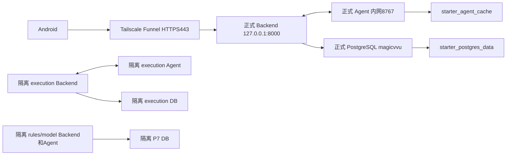
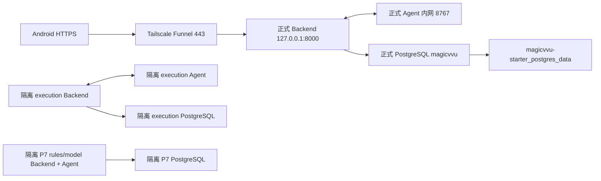

# P0 环境审计

日期：2026-10-20（Asia/Shanghai）。状态：PARTIAL。

<<<<<<< Updated upstream
## 基线与证据边界

已读取用户指定的 `C:/Users/Cavia/Desktop/chat-assistant-team-handoff-20261020.md`，以及实际源码、P7 交接、现有部署说明。原基线 dev/208354a，工作树已有 P8 安全补丁，未覆盖。21:10:42 外部 reset、21:10:45 外部更新至 55ed275；用户明确授权在新基线迁移。本轮仅迁移自己的功能改动，不恢复被外部清除的 P8 补丁；保留新提交的吨/台单位修复。Git reflog 可复核上述时间。

项目：frontend/Kotlin Android；backend/server/FastAPI + SQLAlchemy + Alembic；agent/conversation/P7 + agent/p3、v1 规划；deploy、database、tests、docs。不存在 AGENTS.md。

首次 SSH 审计只读成功：正式 health=200、0.9.0、isolated_test=false；ready=200/database=ok；迁移 20261017_0007(head)。随后 SSH 反复在 banner 阶段超时，Tailscale SSH 也连接超时。最新 HTTPS 复查未取得响应，见 evidence/P1-public-checks.json。首次正常不构成当前可用性保证。首次完整 JSON 被外部清理，以下资源数据保留自本轮工具返回，未冒充重新检查。

## 资源及依赖

| 分类 | 资源 | 首次观察 |
|---|---|---|
| PRODUCTION | magicvvu-starter-backend-1 | p72-units-736c2299edda；healthy；127.0.0.1:8000→8000 |
| PRODUCTION | magicvvu-starter-agent-1 | p72-units-755c1561abc8；healthy；仅内网8767 |
| PRODUCTION | magicvvu-starter-db-1 | PostgreSQL17；healthy；DB magicvvu；仅内网5432 |
| TEST_ONLY候选 | magicvvu-p7-execution-20261017 | backend/agent/db共3个运行容器，DB magicvvu_p7_execution_test |
| TEST_ONLY候选 | magicvvu-p7-test-20261017 | backend/backend-model/agent/agent-model/db共5个运行容器，DB magicvvu_p7_test |
| TEST_ONLY候选 | rehearsal/validation | 5个已停止容器；尚未归档，不删除 |
| SHARED | PostgreSQL基础镜像、Docker、SSH、Tailscale | 必须保留 |
| UNKNOWN | 未挂载结果卷、systemd/cron/额外代理、备份完整范围 | 未完成逐项交叉核对 |

正式 Compose：/srv/magicvvu/magicvvu-starter/deploy/compose.yaml；正式网络 starter_default/starter_ai_net。测试 Compose 位于 /home/admin 下，容器标签、DB名称、无主机端口、独立网络/卷交叉支持隔离判断；尚未完成数据库活动连接和systemd依赖核对，不能直接作为删除授权清单。

首次共16容器/11运行、9网络、11卷。磁盘40G/已用7.7G/可用30G。Docker镜像26、卷约301.4MB。正式卷 magicvvu-starter_postgres_data / magicvvu-starter_agent_cache 必须保留。Funnel首次443→http://127.0.0.1:8000。

## 功能起点与后续

T01 PARTIAL（Release路径已有，未真机验收）；T02 PARTIAL（仅固定三个序号）；T03 NOT_STARTED（503占位）；T04/T05 NOT_STARTED（执行层缺OPEN/DISCARD）；T06/T07 PARTIAL（AI算法已有，规划事实缺失）；T08 PARTIAL（只有手动PLAN_ADD）。本轮结果见各阶段及总报告。

差异：线上已是p72-units镜像，不能按历史标签回滚；当前新本地基线包含单位修复。P8补丁未部署，不能当作线上已加固。

## 清理风险和白名单

**可执行删除白名单为空。** 找到历史dump元数据，不代表最新正式备份已可恢复。SSH中断，无法核对当前依赖、备份恢复、停止测试影响、运维账号ACL或配置回滚。保留PRODUCTION/SHARED/UNKNOWN，不能仅凭test名称删除。

顺序：P1正式候选→P2续接引用→P3执行迁移→P4真实规划读取→P5重验机制→P6隔离PostgreSQL→满足真机/备份等前置条件后P7→P8。普通本地开发继续；无可靠回滚的生产变更停止。
=======
## 基线与证据

本地 dev / `208354a`，已有 P8 安全补丁未提交；保持原样，不整体暂存、不覆盖、不自动拉取合并。主要交接文档已从用户确认路径 `C:/Users/Cavia/Desktop/chat-assistant-team-handoff-20261020.md` 补读，并与当前实现核对；不将文档末尾“本次交付仅新增文档”的历史范围当作当前执行指令。

结构：frontend（Kotlin Android）、backend/server（FastAPI/SQLAlchemy/Alembic）、agent（P7 conversation + P3 planning）、deploy、database、tests、docs。

实时证据：[P0-server-audit.json](evidence/P0-server-audit.json)。由 `tools/p72_server_audit.py` 经已有 SSH alias 只读执行，不输出凭据。正式迁移 `20261017_0007 (head)`；health 200 / version 0.9.0 / isolated_test=false；ready 200 / database=ok。

## 资源关系

PRODUCTION：magicvvu-starter-backend-1（p72-units-736c2299edda）、agent-1（p72-units-755c1561abc8）、db-1（postgres:17）。网络 starter_default / starter_ai_net；持久卷 starter_postgres_data / starter_agent_cache；全部保留。正式代码 `/srv/magicvvu/magicvvu-starter`。

TEST_ONLY 候选：Compose `magicvvu-p7-execution-20261017` 的 3 个运行容器、`magicvvu-p7-test-20261017` 的 5 个运行容器。数据库名分别 magicvvu_p7_execution_test / magicvvu_p7_test；无 host 端口，网络和数据库卷与正式环境分离。另有 5 个已退出 rehearsal / validation 容器。各完整 ID、挂载、标签和连接见证据。

SHARED：postgres 镜像与必要 Docker/Tailscale/SSH 基础设施。UNKNOWN：未挂载结果卷、测试专用 systemd/cron/路由、其他备份范围；未充分核对，不删除。

## T01–T08 起始状态

| 任务 | 状态 | 实际缺口 |
|---|---|---|
| T01 | PARTIAL | Release HTTPS 参数和环境保护已有；需构建及设备全链路验收 |
| T02 | PARTIAL | UI 仅第一个/第二个/第三个；每字段输入未独立保存 |
| T03 | NOT_STARTED | reference-messages 是明确 503 占位；AI 内部已具备引用协议 |
| T04 | NOT_STARTED | OPEN 无业务 DTO/执行/账本约束支持 |
| T05 | NOT_STARTED | DISCARD 同上；不可复用 DELETE |
| T06 | PARTIAL | Consumed 审计存在，内部 planning/context 缺失 |
| T07 | PARTIAL | P3 算法存在，缺业务可信观察覆盖及库存核对事实 |
| T08 | PARTIAL | P3 建议算法及手动 PLAN_ADD 存在，自动建议确认重验未实现 |

与交接基线差异：线上标签已为 p72-units；版本仍 0.9.0。P8 文档/未提交代码不能当作线上已部署证据。未进行正式登录、库存写入或模型调用。

## 删除风险与白名单

当前**可执行删除白名单为空**。上面的 TEST_ONLY 是审计候选，不能据此直接执行删除。仅备份文件存在不能证明可恢复；找到历史 dump，但尚无本轮恢复演练。仍需：数据库连接交叉核对、systemd/cron 检查、历史归档、临时测试替代、关键业务验收、正式最新备份恢复验证、停止测试后的正式健康复核。禁止 prune / down -v / 删除项目根目录。

## 后续顺序

P1 正式候选构建与只读 HTTPS；P2 零模型续接与真实引用；P3 扩展原 Draft/Commit 及增量迁移；P4 真实规划快照并如实标记覆盖缺失；P5 建议依据重验；P6 隔离 PostgreSQL + Android 检查；满足前置条件才进入 P7、P8。未验证项目分别标 NOT_VERIFIED，阻塞生产步骤不冒险执行。
>>>>>>> Stashed changes
