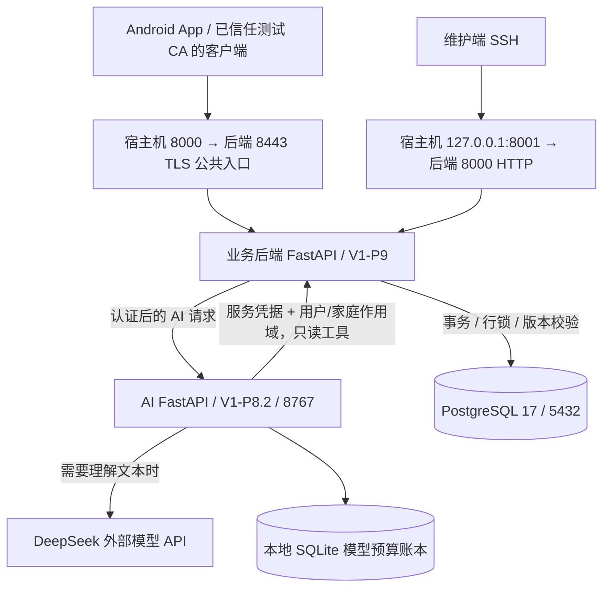
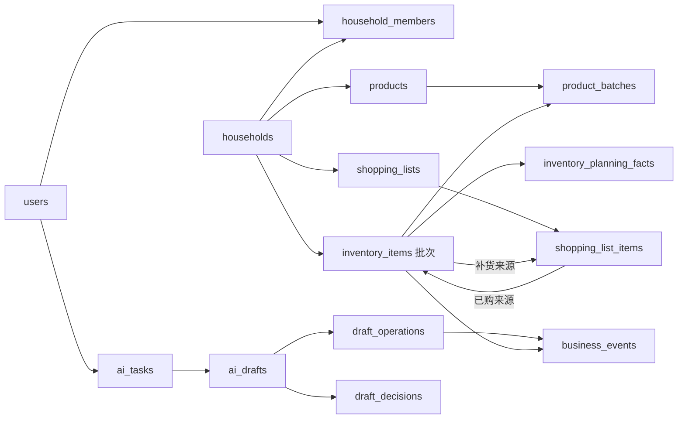

# MagicVVu / Mewstow 服务器架构与功能全景

> 扫描日期：2026-10-26，Asia/Shanghai。主要运行快照：23:27；网络验证：23:28 起。  
> 对象：通过现有 `ssh magicvvu` 访问的正式服务器，以及当前仓库源码。  
> 本地源码基线、完整运行元数据见同目录 `runtime-inventory.json`。本文件描述扫描时状态，不代表以后自动更新。

## 1. 先看结论

目前服务器是一套**单机 Docker Compose 部署的家庭共享库存系统**，核心由三个服务组成：

1. **业务后端**：Python + FastAPI，负责账号、家庭权限、库存、购物清单、AI 任务和草稿、确认执行、会话记录、商品身份和事件账本。
2. **AI 服务**：Python + FastAPI，当前使用 DeepSeek，负责理解文本、查询库存、澄清、生成操作草稿、风险和规划分析；正式库存与购物清单的写入由业务后端执行。
3. **数据库**：PostgreSQL 17，保存业务数据、会话、草稿、执行回执和事件。

Android App 是访问服务器的客户端；服务器没有运行 Android UI。当前活跃主链路没有独立 Nginx 网关、Redis、消息队列或向量数据库容器。AI 的本地规则目录不能据此理解为已部署完整向量检索系统。

### 当前线上版本与实测结果

| 项目 | 本次实测 |
| --- | --- |
| 业务后端镜像 | `magicvvu/backend:p9-20261026` |
| 后端 API / 维护版本 | `0.9.0` / `V1-P9` |
| AI 镜像 | `magicvvu/agent:p82-05fa3203a7cb` |
| AI 维护版本 / 引擎 | `V1-P8.2` / `deepseek` |
| 数据库版本 | PostgreSQL `17.11` |
| 数据库迁移 | `20261026_0011` |
| 数据表 | 21 张，含 `alembic_version`；即 20 张业务表 |
| 后端接口规模 | OpenAPI 中 52 个不同路径；完整方法清单见附录 A |
| AI 接口规模 | OpenAPI 中 13 个路径，见附录 B |
| 容器健康 | backend、agent、db 全部 `healthy`，本次快照重启计数均为 0 |
| P9 只读预检 | 16/16 通过；预检明确没有业务写入和模型调用 |
| 公网 HTTPS | 本机信任项目测试 CA 后访问健康接口，返回 200 / P9 |
| 后端源码核验 | `app/`、`alembic/` 共 68 个 Python 文件，与本地 SHA-256 全部相同 |
| AI 源码核验 | 扫描的 81 个 Python 文件全部对应本地文件；统一 CRLF/LF 后 81/81 相同，原始字节相同为 6/81 |
| 实际 TLS 启动脚本 | 宿主机挂载的 `serve.py` 与仓库文件 SHA-256 一致 |

**当前最重要的功能边界**：六类动作可确认执行；自动计算补货的直接提交仍关闭；生效的人工审核风险规则数量为 0；P9 后端商品聚合已存在，但正式 AI 仍未消费其完整新扩展；部分服务器能力尚未接入当前 Android 页面。

本次扫描没有创建账号、发送聊天、执行草稿、修改库存、调用付费模型、迁移数据库或调整网络。功能描述来自实际运行路由、能力声明、数据库结构和匹配源码；没有把只读预检当作所有业务端到端验收。

## 2. 总体架构



### 架构上的三个关键点

- **后端处于业务中心**：数据库账号、用户认证、家庭权限和最终写事务集中在业务后端。AI 容器连接 AI 网络，数据库容器连接业务数据库网络，后端同时连接两张网络。
- **自然语言结果不直接写库**：AI 先回答、提出澄清或生成草稿；客户端明确确认后，后端再次核对版本、权限与幂等信息，再写库存或待购清单。
- **业务状态持久化在后端**：任务、会话、草稿、决定、回执均入 PostgreSQL；AI 的请求上下文与预算账本有不同职责，不能把历史对话当成当前库存事实。

## 3. 宿主机、容器与资源

### 3.1 宿主机

| 项目 | 扫描结果 |
| --- | --- |
| 系统 | Ubuntu 24.04.5 LTS |
| 内核 / 架构 | Linux `6.8.0-63-generic` / x86_64 |
| CPU | 2 个逻辑 CPU |
| 内存 | 约 1.6 GiB；扫描初始采样约 720 MiB 已用，892 MiB 可用 |
| Swap | 2.0 GiB，采样时未使用 |
| 根磁盘 | 40 GiB，约 7.8 GiB 已用、30 GiB 可用，使用率 21% |
| Docker / Compose | `29.9.0` / `5.6.0` |
| 运行时长 | 约 5 天 16 小时 |

这些是低负载瞬时采样，不能用来推算高峰承载能力或并发用户上限。

### 3.2 正式容器

| 容器 | 启动入口 | 内存上限 / CPU 配额 | 特征 |
| --- | --- | --- | --- |
| `magicvvu-starter-backend-1` | `python /app/magicvvu_direct.py` | 384 MiB / 0.75 CPU | UID 10001；只读根文件系统；同时提供内网 HTTP 和公共 TLS |
| `magicvvu-starter-agent-1` | `python -m uvicorn conversation.app:create_app --factory --host 0.0.0.0 --port 8767` | 256 MiB / 0.65 CPU | UID 10002；只读根文件系统；`no-new-privileges` |
| `magicvvu-starter-db-1` | PostgreSQL 官方入口 | 384 MiB / 0.75 CPU | 数据写入独立命名卷 |

三个容器均使用 `unless-stopped` 重启策略；Docker 日志使用 `local` 驱动，单文件上限 `10m`，最多 3 个文件。扫描时后端约 72 MiB、AI 约 63 MiB、数据库约 49 MiB；数值会随请求和缓存变化。

后端与 AI 都是 Python `3.12.15`，但依赖版本不同，应各自维护：

| 组件 | 后端 | AI |
| --- | --- | --- |
| FastAPI | 0.116.1 | 0.135.1 |
| Pydantic | 2.14.1 | 2.12.5 |
| Uvicorn | 0.35.0 | 0.42.0 |
| 数据库访问 | SQLAlchemy 2.0.44 / Psycopg 3.2.12 | 通过后端 HTTP 只读工具 |
| 迁移工具 | Alembic 1.17.0 | 无业务库迁移职责 |

## 4. 网络入口、HTTPS 和访问范围

### 4.1 端口与 Docker 网络

| 地址或端口 | 实际用途 | 访问范围 |
| --- | --- | --- |
| 公网 `8.134.172.165:8000` | 映射后端容器 `8443`，HTTPS | 宿主机绑定 `0.0.0.0`；本次工作站实测可达 |
| `127.0.0.1:8001` | 映射后端容器 `8000`，HTTP | 宿主机回环地址，维护可经 SSH 使用 |
| Docker 内 `backend:8000` | AI 读取库存、规划上下文与操作凭证 | AI 网络中的服务通信 |
| Docker 内 `agent:8767` | 后端调用 AI | 未发布到宿主机 |
| Docker 内 `db:5432` | 后端连接 PostgreSQL | 未发布到宿主机 |
| `22/tcp` | SSH 维护 | 宿主机监听 IPv4 / IPv6 |

实际网络为 `magicvvu-starter_ai_net`（`172.20.0.0/16`）和 `magicvvu-starter_default`（`172.18.0.0/16`），均为 bridge，`Internal=false`。这里的“内网”指服务未发布公网端口与网络成员关系；不能把它解释成 Docker `internal: true` 的禁止外连网络。AI 需要出站调用 DeepSeek。

### 4.2 真正处理 TLS 的文件

仓库文件：[deploy/ip-direct/serve.py](../../deploy/ip-direct/serve.py)。线上文件为 `/srv/magicvvu/ip-direct/serve.py`，只读挂载到容器 `/app/magicvvu_direct.py`。

这个脚本在同一 Python 进程中启动两个 Uvicorn 监听器：

- `8000`：原始 FastAPI 应用，供内部调用。
- `8443`：经 `PublicAPI` 包装的 TLS 应用，供外部客户端调用。

`PublicAPI` 只放行 `/api/v1/…` 与 `/health`，明确隐藏 readiness 和内部工具入口；限制请求体为 64 KiB；按真实 TCP 对端对认证类请求限制 8 次/分钟、其他 API 120 次/分钟；公共监听设置并发限制 32。它不信任代理头，WebSocket 请求会被拒绝。`/health` 会转到 `/api/v1/health`。

本次没有运行中的 `nginx.service`、`tailscaled.service` 或 `magicvvu-public-gateway.service`。仓库里的 Nginx candidate、历史 Tailscale 报告不能当作当前入口架构。

### 4.3 证书与网络实测

证书签发者为 `MagicVVu Internal Test CA`，服务端证书对应公网 IP，有效期截至 **2027-01-19 19:12:40（北京时间）**。这套部署依赖客户端信任项目 CA，不能等同于通用浏览器默认信任的公共 CA 证书。

公开证书挂载目录是 `/etc/magicvvu/ip-direct/tls` → `/run/magicvvu-tls`，只读。测试 CA 位于客户端 [magicvvu_test_ca.pem](../../frontend/app/src/debug/res/raw/magicvvu_test_ca.pem)。扫描只读取公开证书元数据，没有读取私钥。

| 请求 | 本次结果 |
| --- | --- |
| 工作站直接 HTTPS 请求 `/api/v1/health` | 200，证书和 IP 主机名校验开启，返回 P9 |
| 服务器本地经相同 IP/TLS 入口请求 health | 200 |
| TLS 请求执行能力，未带用户令牌 | 401 |
| TLS 请求 `/internal/v1/planning/context` | 404 |
| TLS 请求 `/api/v1/ready` | 404 |
| TLS 请求 `/openapi.json` | 404 |

当前 `magicvvu-direct-firewall.service` 已 masked，`DOCKER-USER` 链没有附加规则。因此历史“来源 IP 白名单”描述不能直接沿用。扫描未查看云控制台安全组或穷举所有防火墙规则，不据此断言全部网络访问策略；已确认的事实是工作站当时可访问业务 HTTPS，内部 HTTP/AI/DB 没有相应公网端口映射。

## 5. 后端代码分层与全部主要功能

正式后端代码根目录是 **`backend/server/`**，容器内是 `/app/`。真实业务应用入口为 [app/main.py](../../backend/server/app/main.py)，生产启动外层则是上一节的 `serve.py`。

```text
backend/server/
  app/main.py                 FastAPI 装配、health 与 readiness
  app/routers/                HTTP 路由、认证与请求编排
  app/services/               执行、会话、规划、购物、账本业务逻辑
  app/*_schemas.py            Pydantic 请求与响应契约
  app/*_models.py、models.py  SQLAlchemy 数据模型
  app/database.py             数据库连接与会话
  app/dependencies.py         用户身份与请求级 DB 会话
  app/security.py             密码、令牌和时间处理
  alembic/versions/           增量数据库迁移
  tests/                     本地和隔离环境回归测试
```

### 5.1 账号与登录

支持手机号密码注册、登录、退出、读取和修改个人资料。手机号会标准化为 E.164；中国大陆 11 位手机号可转为 `+86` 形式。当前 `AUTH_ALLOW_UNVERIFIED_SIGNUP=true`，允许未短信验证的注册；**手机号是登录标识，尚未证明号码所有权**，没有已接通的短信验证码或短信找回链路。

密码使用 Argon2；登录后发放不透明 Bearer token，数据库只保存 SHA-256 摘要。默认会话有效期 12 小时；退出写撤销时间；停用用户或过期、撤销令牌均不能继续访问。

| 职责 | 文件 |
| --- | --- |
| HTTP 接口与资料更新 | [routers/auth.py](../../backend/server/app/routers/auth.py) |
| 注册/登录等字段规则 | [schemas.py](../../backend/server/app/schemas.py) |
| 密码哈希、令牌生成与过期 | [security.py](../../backend/server/app/security.py) |
| 当前身份解析 | [dependencies.py](../../backend/server/app/dependencies.py) |
| 按 IP、账号、全局和并发限制登录 | [login_guard.py](../../backend/server/app/login_guard.py) |
| 用户、登录会话模型 | [models.py](../../backend/server/app/models.py) |

`LoginGuard` 为进程内状态，默认限制包括 IP 30 次/60 秒、账号 8 次/300 秒、全局 120 次/60 秒和最多 4 个同时登录计算。当前单进程运行与该实现匹配；增加副本或多 worker 前，需要重新设计共享限流。

### 5.2 家庭与成员管理

支持创建/列出家庭、重命名、查看成员、生成一次性邀请码、加入家庭、退出家庭、移除成员、设置管理员、转让所有权和按名称确认解散家庭。

家庭拥有 `owner/admin/member` 角色；所有者负责所有权、角色及解散等操作。创建家庭时同步创建家庭唯一共享购物清单；邀请码只保存摘要，默认 30 分钟有效且一次使用。成员变化会撤销未使用邀请，避免旧权限继续有效。

主要代码：[routers/households.py](../../backend/server/app/routers/households.py)、[schemas.py](../../backend/server/app/schemas.py)、[models.py](../../backend/server/app/models.py)。家庭成员校验与事务锁也在该模块及执行服务中复用。

### 5.3 库存批次管理

支持分页读取、新建、查看单批次、修改、数量调整、归档删除、关联原事件的数量更正。库存按批次保留独立的采购来源、位置、开封时间、到期日、单位、最低库存和版本。

- 默认列表返回 `ACTIVE/FINISHED`；可显式请求 `DISCARDED/REVERSED/all` 查看历史状态。
- 修改、调整、更正及删除携带 `operation_id` 和 `expected_version`，结合行锁防止陈旧覆盖和重复执行。
- “删除库存”转为 `DISCARDED` 并保留历史；不等于永久删除所有证据，也不代表已有恢复/撤销接口。
- 数量调整与更正不作为消费；更正必须指向同家庭同批次的原事件，并提供原因。
- `history_json` 只保留最近 30 条摘要，P9 持久事件账本另行保存。

代码：[routers/inventory.py](../../backend/server/app/routers/inventory.py)、[inventory_schemas.py](../../backend/server/app/inventory_schemas.py)、[shopping_schemas.py](../../backend/server/app/shopping_schemas.py)、[services/ledger.py](../../backend/server/app/services/ledger.py)、[models.py](../../backend/server/app/models.py)。

### 5.4 共享购物清单与购买入库

支持待购/已购列表、新建、修改、删除未购项，以及确认购买并原子入库。不同购物项即使同名也创建不同批次。重复购买返回原库存批次，不重复入库；第一次确认的位置、日期等不会被延迟重试覆盖。

P9 已允许编辑旧采购的 `source_inventory_item_id`：省略表示保留、UUID 表示设置、显式 null 表示清空。编辑可带服务器返回的 `version`、稳定 `operation_id`，进行并发保护并保存永久回执。购物项版本是响应契约计算的内容版本，不是数据库表中新增的一列。

购买时使用行锁、来源唯一约束和单事务，保证“标记已购＋创建库存＋记账”共同成功。显式来源批次若已映射商品，新批次继承商品关联；已购项作为历史保留。

代码：[routers/shopping.py](../../backend/server/app/routers/shopping.py)、[services/shopping.py](../../backend/server/app/services/shopping.py)、[shopping_schemas.py](../../backend/server/app/shopping_schemas.py)、[services/ledger.py](../../backend/server/app/services/ledger.py)。

### 5.5 AI 网关、任务和澄清

后端接收用户文本并校验家庭成员身份，再携带服务认证和可信用户/家庭作用域调用 AI。它保存任务状态、原请求摘要、澄清上下文、修订号、处理租约和草稿。

`request_id` 用于恢复同一请求；相同标识不能换内容。处理 nonce、租约和数据库唯一约束约束重复及并发请求；超时后应读取原任务或使用原请求恢复，而不是盲目新建任务。AI 返回的用户/家庭、原始文本、引用对象与结果结构都会被校验。

代码：[routers/agent_gateway.py](../../backend/server/app/routers/agent_gateway.py)、[models.py](../../backend/server/app/models.py)、[conversation_schemas.py](../../backend/server/app/conversation_schemas.py)。旧兼容接口为 `/api/v1/agent/messages`、`clarifications/{task_id}` 和 `tasks/{task_id}`。

### 5.6 对话续接、可信引用和草稿文字控制

已有 `conversation-messages` 兼容入口、对话对象引用和 `chat-control`。它们把“这一批”“第二个”等输入绑定到服务端校验过的批次/任务，不接受客户端任意拼装可信内部上下文。草稿文字控制可修改允许字段、取消或继续澄清，最终执行仍走独立确认接口。

代码：[routers/conversation.py](../../backend/server/app/routers/conversation.py)、[services/conversation.py](../../backend/server/app/services/conversation.py)、[services/chat_controls.py](../../backend/server/app/services/chat_controls.py)、[conversation_models.py](../../backend/server/app/conversation_models.py)、[conversation_schemas.py](../../backend/server/app/conversation_schemas.py)。

### 5.7 云端会话记忆、历史和中断恢复

`conversation-memory-1` 已部署，提供当前会话读取、重置、新一轮消息和按 `request_id` 恢复。历史读取窗口为最近 30 天；AI 理解上下文默认最多最近 10 轮，并有字节上限。

会话 ID、修订、当前任务和执行证据由后端维护。历史回答不等于当前任务状态；读取活动任务会重新检查执行状态和库存版本。30 天是读取/上下文窗口，本次没有证据证明物理数据会在第 30 天自动删除。

代码：[routers/session_memory.py](../../backend/server/app/routers/session_memory.py)、[services/session_memory.py](../../backend/server/app/services/session_memory.py)、[memory_schemas.py](../../backend/server/app/memory_schemas.py)。复用 `ai_conversation_bindings/ai_conversation_turns`，没有单独记忆数据库。

### 5.8 草稿预览、确认执行和永久回执

实际能力声明六类动作均开启：

| 动作 | 业务含义 |
| --- | --- |
| `ADD` | 新增库存 |
| `MOVE` | 移动库存批次位置 |
| `CONSUME` | 消费库存，包含受保护的全部消费场景 |
| `PLAN_ADD` | 人工明确的待购项加入共享清单 |
| `OPEN` | 标记开封 |
| `DISCARD` | 丢弃批次 |

草稿有效期能力值为 900 秒。确认时检查任务和草稿修订、成员权限、字段编辑范围、目标版本、数量/单位及终态决定；同一草稿不能既取消又执行，同一操作 ID 不能换请求。库存或清单变化、决定、操作回执和业务事件在事务边界内保存。

`execution-preview` 是只读预览，不延长 TTL、不占用操作号，也不写业务记录。原始操作回执仅操作者可读；家庭共享展示应使用脱敏 summary 接口。

代码：[routers/draft_execution.py](../../backend/server/app/routers/draft_execution.py)、[services/draft_execution.py](../../backend/server/app/services/draft_execution.py)、[execution_models.py](../../backend/server/app/execution_models.py)、[execution_schemas.py](../../backend/server/app/execution_schemas.py)。

### 5.9 规划资料和内部一致快照

每个库存批次可录入带来源和版本的资料：最低库存/覆盖天数/采购提前期/包装规格偏好、逐日记录完整性、缺货与未知调整声明、显式盘点、标签日期类型和储存条件等风险事实。

后端内部规划接口以 PostgreSQL `REPEATABLE READ` 只读事务读取同一快照的库存、事件、购物项、资料和商品关联；提供快照标识、事件水位、版本与来源。上限为 1000 个库存批次、20000 个事件、10000 个购物项，超限拒绝提供不完整预测。

“接口读全”与“现实消费记录完整”分开表达。没有完整性声明不能推断零消费；没有来源关联的待购不能直接按同名算进补货需求。

代码：[routers/planning_facts.py](../../backend/server/app/routers/planning_facts.py)、[services/planning_facts.py](../../backend/server/app/services/planning_facts.py)、[planning_fact_models.py](../../backend/server/app/planning_fact_models.py)、[planning_fact_schemas.py](../../backend/server/app/planning_fact_schemas.py)、[routers/planning.py](../../backend/server/app/routers/planning.py)、[services/planning_context.py](../../backend/server/app/services/planning_context.py)。

### 5.10 P9 商品身份与跨批次聚合

支持创建家庭明确确认的商品，以及把批次关联/解除到商品；同名不会自动归为同商品。商品定义包含名称、规格、基准单位、类别、标签、来源、操作者和版本。

内部规划 provenance 的 `product_aggregates_v1` 已提供逐批资料、可换算总量和非过期活动量。质量和体积仅在支持的同量纲单位间换算；未知换算会标记不完整。聚合结果的 `usable_quantity` 仍可为未知，不能把非过期数量直接称为已验证安全可用量。

代码：[routers/products.py](../../backend/server/app/routers/products.py)、[services/products.py](../../backend/server/app/services/products.py)、[product_models.py](../../backend/server/app/product_models.py)、[product_schemas.py](../../backend/server/app/product_schemas.py)。当前没有公开商品列表/搜索 GET，也没有公开商品聚合 GET，完整手机商品管理还缺读取契约。

### 5.11 P9 持久事件账本和更正

`business_events` 除已有草稿执行事件外，P9 把普通库存录入/编辑/调整/归档、购买入库、商品关联和更正纳入持久事件。可按家庭和批次分页读取，记录操作人、前后值、发生/记录时间、请求或执行来源、关联原事件等。

关联更正通过 `related_event_id` 和原因保留证据链，调整/更正与 `Consumed` 消费事件保持不同语义。P9 没有补写全部历史普通 CRUD，因此完整事件接口不等于“项目开始以来现实所有变化都已记录”。

代码：[services/ledger.py](../../backend/server/app/services/ledger.py)、[execution_models.py](../../backend/server/app/execution_models.py)、[routers/products.py](../../backend/server/app/routers/products.py)、[routers/inventory.py](../../backend/server/app/routers/inventory.py)。

### 5.12 自动建议重验、操作摘要和 AI 反馈

- **自动建议重验**：`planning-revalidation` 从保存的原建议读取依据，与新快照比较，返回 `stale/blocked`、变化项和阻断原因；当前只读，不落自动采购。代码：[services/planning_revalidation.py](../../backend/server/app/services/planning_revalidation.py)。
- **家庭共享摘要**：同家庭成员可读取脱敏操作摘要，不必获得操作者完整原回执。代码：[routers/assistant_reads.py](../../backend/server/app/routers/assistant_reads.py)。
- **AI 兼容扫描**：分页检查库存是否能转换为 AI 契约，给出问题批次和字段；一页兼容不等于整个家庭全部兼容。代码同上，转换逻辑见 [services/ai_inventory.py](../../backend/server/app/services/ai_inventory.py)。
- **操作后反馈**：业务提交成功后单独请求 AI，只读结果分为 `available/partial/unavailable/not_applicable`；反馈失败不撤销成功业务，也不能触发重复执行。`PLAN_ADD` 当前返回 `not_applicable`，因为尚未购买或改变库存。代码同上。

## 6. AI 服务的结构与功能

### 6.1 当前入口及层级

线上只运行一个 AI 容器，入口是 [agent/conversation/app.py](../../agent/conversation/app.py) 的 `create_app`。目录中多个阶段模块通过继承、委托和共用类型组成当前服务，**并非同时运行 P0/P1/P2/P3/P7 多个独立微服务**。

| 模块 | 当前链路中的职责 | 关键文件 |
| --- | --- | --- |
| `conversation/` | 当前入口、有限上下文、可信引用、聊天分流、会话理解 | [app.py](../../agent/conversation/app.py)、[manager.py](../../agent/conversation/manager.py)、[engines.py](../../agent/conversation/engines.py)、[memory.py](../../agent/conversation/memory.py) |
| `conversation/` 回复适配 | 澄清续接、编号选择、草稿回复和补充信息 | [replies.py](../../agent/conversation/replies.py)、[reply_adapter.py](../../agent/conversation/reply_adapter.py)、[supplements.py](../../agent/conversation/supplements.py)、[scoped_queries.py](../../agent/conversation/scoped_queries.py) |
| `v1/` | 统一业务编排、库存/规划/操作凭证读取、只读反馈、规则审核边界 | [manager.py](../../agent/v1/manager.py)、[tools.py](../../agent/v1/tools.py)、[knowledge.py](../../agent/v1/knowledge.py)、[render.py](../../agent/v1/render.py) |
| `interaction/` | 已确认输入文本策略、生命周期任务与续接 | [manager.py](../../agent/interaction/manager.py)、[policy.py](../../agent/interaction/policy.py)、[tasks.py](../../agent/interaction/tasks.py) |
| `p3/` | 消费历史统计、条件耗尽预测、采购建议 | [history.py](../../agent/p3/history.py)、[forecast.py](../../agent/p3/forecast.py)、[procurement.py](../../agent/p3/procurement.py)、[manager.py](../../agent/p3/manager.py) |
| `p2/` | 风险评价、本地规则和扩展库存读取 | [risk.py](../../agent/p2/risk.py)、[knowledge.py](../../agent/p2/knowledge.py)、[rules.json](../../agent/p2/rules.json)、[tools.py](../../agent/p2/tools.py) |
| `p1/` | 开封/移动/丢弃等操作类型、校验与只读批次工具 | [manager.py](../../agent/p1/manager.py)、[domain.py](../../agent/p1/domain.py)、[tools.py](../../agent/p1/tools.py) |
| `p0/` | 基础解析、DeepSeek HTTP 调用、领域约束、预算 | [deepseek.py](../../agent/p0/deepseek.py)、[budget.py](../../agent/p0/budget.py)、[text.py](../../agent/p0/text.py)、[domain.py](../../agent/p0/domain.py) |
| `review/` | 人工规则审核工作流支持 | [rules.py](../../agent/review/rules.py) |

### 6.2 用户能获得哪些 AI 能力

支持库存数量/位置等查询、批次选择与澄清、操作草稿、全部消费的受保护处理、日常库存概览、消费统计、基于证据的条件预测、采购建议、规则风险问答、业务提交后只读反馈，以及有限会话回忆和任务状态解释。

其中预测、风险、补货是**受数据与审核条件约束的能力**：资料不足会返回缺口、未知或阻断结果，不保证每个现有家庭都能得到完整预测。运行 health 的 `active_human_rule_count=0`，不能声称平台已经对物品安全性给出经人工审核的确定结论。

### 6.3 模型调用与预算

运行配置选择 `deepseek`；模型请求实现位于 [p0/deepseek.py](../../agent/p0/deepseek.py) 及各层 [conversation/engines.py](../../agent/conversation/engines.py) 等适配器。模型供应商请求使用 JSON 结构化输出，有调用时限、输入/输出上限和响应校验。

[p0/budget.py](../../agent/p0/budget.py) 通过 SQLite 保存调用预留与实际用量，调用前按费率保守预留；用量未知时保留预留金额。代码默认累计预算上限为 20 元；本次没有读取预算金额、余额或模型账单，也没有调用模型验证供应商连通性。

预算文件位于 `.cache/p0/budget.sqlite`，有独立持久挂载；费率文件为宿主机 `/srv/magicvvu/team-agent/pricing.json`，只读挂载到 `eval/pricing.json`。聊天中明确的本地分流、澄清和回复解析可零模型完成；自然语言理解可能调用外部模型，不能把“有规则解析”理解为所有请求免费。

### 6.4 服务之间怎样认证

业务后端调用 AI 使用 `AI_SERVICE_TOKEN`，并传入已认证的用户和家庭标识。AI 回读后端使用 `BACKEND_TOOL_TOKEN`，后端继续核验用户有效性、成员资格和资源归属。

AI 可读接口包括库存搜索、单批次、规划快照和操作凭证。其能力声明 `inventory_writes=false / shopping_writes=false`；AI 的对话结果或模型输出不能越过后端确认接口直接写业务库。令牌值、数据库密码、用户资料及模型密钥未写入本报告。

## 7. 数据模型与持久化

### 7.1 数据表职责

实际数据库大小约 9.17 MiB，包含索引和系统对象等，不是单纯库存数据文件体积。本次仅读取结构和数据库大小，没有导出任何业务行。

| 分组 | 表名 | 主要用途 | 模型文件 |
| --- | --- | --- | --- |
| 用户 | `users` | 用户、手机号、密码哈希、启停状态 | `app/models.py` |
| 用户 | `auth_sessions` | token 摘要、到期和撤销 | `app/models.py` |
| 家庭 | `households` | 家庭基本信息 | `app/models.py` |
| 家庭 | `household_members` | 家庭成员和角色 | `app/models.py` |
| 家庭 | `household_invitations` | 一次性邀请码摘要和使用信息 | `app/models.py` |
| 库存 | `inventory_items` | 库存批次、版本、来源与摘要历史 | `app/models.py` |
| 采购 | `shopping_lists` | 家庭共享购物清单 | `app/models.py` |
| 采购 | `shopping_list_items` | 待购/已购项、来源库存和购买者 | `app/models.py` |
| AI | `ai_tasks` | 任务、租约、请求摘要、澄清及结果 | `app/models.py` |
| AI | `ai_drafts` | 待确认命令和预览、修订 | `app/models.py` |
| 执行 | `draft_operations` | 已执行命令、请求摘要和永久回执 | `app/execution_models.py` |
| 执行 | `draft_decisions` | 草稿的执行或取消终态决定 | `app/execution_models.py` |
| 账本 | `business_events` | 前后值、动作、关联事件及证据来源 | `app/execution_models.py` |
| 会话 | `ai_conversation_bindings` | 当前用户会话、任务与引用游标 | `app/conversation_models.py` |
| 会话 | `ai_conversation_turns` | 请求、理解、阶段和持久响应 | `app/conversation_models.py` |
| 规划 | `inventory_planning_facts` | 版本化的显式规划/风险资料 | `app/planning_fact_models.py` |
| 规划 | `planning_fact_writes` | 规划资料写入幂等回执 | `app/planning_fact_models.py` |
| 商品 | `products` | 家庭确认的稳定商品身份 | `app/product_models.py` |
| 商品 | `product_batches` | 商品到库存批次的显式映射 | `app/product_models.py` |
| 通用回执 | `mutation_receipts` | P9 业务修改请求摘要与原响应 | `app/product_models.py` |
| 迁移 | `alembic_version` | 当前数据库 schema 版本 | `alembic/` |

### 7.2 主要关系



图示为主要业务关系，完整字段、外键和唯一约束见 `runtime-inventory.json`，附录 C 列出全部实际字段。P9 后普通业务事件可没有草稿 `operation_id`，此时通过 `request_id` 和修改回执证明来源。

### 7.3 数据实际存在哪里

| 数据 | 存储位置 |
| --- | --- |
| PostgreSQL 业务数据 | Docker 卷 `magicvvu-starter_postgres_data` → `/var/lib/postgresql/data` |
| AI 一般缓存 | Docker 卷 `magicvvu-starter_agent_cache` → `/app/agent/.cache` |
| AI 预算账本 | 宿主机 `/home/magicvvu_ai/workspace/agent/.cache/p0` → `/app/agent/.cache/p0`，覆盖该子目录 |
| 模型费率配置 | 宿主机 `/srv/magicvvu/team-agent/pricing.json` → AI `eval/pricing.json`，只读 |
| TLS 证书材料 | 宿主机 `/etc/magicvvu/ip-direct/tls` → 后端 `/run/magicvvu-tls`，只读 |
| 发布与私有备份 | 既有发布记录所述 `/srv/magicvvu/releases/...` 受限目录 |

业务数据主要在 PostgreSQL 命名卷，重建应用容器不应删除卷。预算持久化也独立于 AI 镜像。完整备份存在并不等于已有异地容灾或自动定期恢复验证；历史 P9 发布记录确认过隔离恢复演练，本次没有再次恢复或读取备份内容。

## 8. 三条关键业务链路

### 8.1 自然语言 → 草稿 → 执行

1. App 通过登录 token 发文本到后端；后端校验家庭、请求 ID 和会话修订。
2. 后端调用 AI；AI 按需调用 DeepSeek，并通过内部工具读取最新库存。
3. 信息不足则返回澄清；可执行意图生成草稿，由后端持久化，尚不写库存。
4. 用户核对预览并确认；后端检查草稿 TTL、版本、权限、字段和原操作标识。
5. 同一事务写库存/待购、执行决定、回执和事件；客户端按原回执恢复，不重复扣库存。

对应核心文件：`routers/session_memory.py → services/session_memory.py → agent/conversation/memory.py/manager.py → routers/draft_execution.py → services/draft_execution.py`。旧兼容入口仍走 `agent_gateway.py` 和 `services/conversation.py`。

### 8.2 待购 → 购买 → 新批次

1. 家庭共享清单中存在未购项，可有显式来源库存。
2. 购买接口锁定购物项并再次校验家庭权限。
3. 同一事务标记已购、创建新库存、保存来源与商品映射、记持久事件。
4. 相同购物项重试读取同一批次，返回 `newly_stocked=false`。

对应文件：`routers/shopping.py → services/shopping.py → services/ledger.py`。

### 8.3 统计/预测 → 建议 → 自动提交边界

1. 后端生成一致的库存、事件、待购和资料快照。
2. AI 的历史/预测/采购模块只基于可验证的记录计算。
3. 资料缺失、未审核规则、盘点过期或待购关联未知会产生数据缺口或阻断。
4. P9 重验接口比较保存的建议依据和新快照，报告 stale/blocked。
5. 当前 `automatic_planning_commit=false`、`manual_plan_only=true`，自动计算建议不能直接提交；人工明确待购走既有受控路径。

对应文件：`services/planning_context.py → agent/v1/tools.py → agent/p3/history.py/forecast.py/procurement.py`；确认诊断由 `services/planning_revalidation.py` 负责。

## 9. 哪些已经具备，哪些还没有完成

### 9.1 当前可以明确确认的线上能力

账号登录和家庭隔离、库存批次 CRUD、共享购物与原子入库、六类草稿执行、可信引用、文字续接/草稿控制、执行预览、云端会话记忆和恢复、规划事实读写、商品显式映射、持久账本、更正、家庭摘要、兼容扫描和操作后反馈均有实际运行路由和实现。

这表示服务器实现和入口已在运行。除本次健康/认证/隔离探测外，本次没有重新执行这些写入流程；可结合 [P9 生产发布记录](../../docs/versions/V1-P9/backend-ai-p9-production-release.md) 的历史专用家庭验收理解其测试范围。

### 9.2 服务器或 AI 仍有明确边界

| 能力 | 当前边界 |
| --- | --- |
| 自动补货直接提交 | 显式关闭，重验接口只做诊断，不能当成已实现自动下单 |
| 人工审核风险规则 | 生效数量为 0，用户填标签不能代替平台规则审核 |
| P9 商品聚合进入正式 AI | 聚合位于返回的 provenance；AI `p2/tools.py` 仍只提取响应 `data`，新聚合和 basis 尚未完整进入 AI Reader |
| 完整商品管理 | 有创建与关联写接口，缺公开列表/搜索/聚合读接口 |
| 历史完整账本 | P9 起新增持久覆盖并保留旧草稿事件；没有补齐全部旧普通 CRUD |
| 云图片识别与图片同步 | 没有相应正式服务端链路；当前手机照片能力是本地 OCR 等，不能算作服务器云识别 |
| 云 ASR/TTS、音频上传 | AI health 明确 `audio_upload_supported=false`；现有语音输入以客户端转文本为主 |
| WebSocket/系统推送 | 当前公共包装器拒绝 WebSocket；未见已部署推送服务链路 |
| 短信验证/找回 | 未接通；未验证手机号仍只作登录标识 |
| 水平扩容和高可用 | 单机、单套数据库、单 AI 实例；没有已部署多副本切换机制证据 |

### 9.3 服务器已有但当前 Android 尚未完整承接

按当前源码与当日 [前后端对接审计](../frontend-backend-audit-20261026/audit-report.md)，重点包括：

- 云端新会话协议、历史和中断恢复：前端仍主要走旧 conversation-messages、本地历史。
- 旧采购来源修改与版本/回执：后端 P9 已有，前端尚未完整携带和展示。
- 同家庭其他成员的操作：应调用共享 summary，当前流水按钮仍可能调用操作者私有原回执。
- 商品映射、完整账本、关联更正、操作后反馈、服务端兼容扫描和归档列表：尚未完整形成客户端入口。

前端主要定位文件：[AgentClient.kt](../../frontend/app/src/main/java/com/example/teamapp/data/AgentClient.kt)、[AssistantStore.kt](../../frontend/app/src/main/java/com/example/teamapp/data/AssistantStore.kt)、[CloudApi.kt](../../frontend/app/src/main/java/com/example/teamapp/data/CloudApi.kt)、[CloudStore.kt](../../frontend/app/src/main/java/com/example/teamapp/data/CloudStore.kt)、[CloudPanels.kt](../../frontend/app/src/main/java/com/example/teamapp/ui/CloudPanels.kt)、[ConsumptionEventsPanel.kt](../../frontend/app/src/main/java/com/example/teamapp/ui/ConsumptionEventsPanel.kt)。本次未核验手机已安装 APK 与当前源码一致性。

## 10. 部署、开机、续期与检查文件

### 10.1 线上实际配置与仓库文件的关系

| 用途 | 文件或路径 | 说明 |
| --- | --- | --- |
| 正式 Compose | 服务器 `/srv/magicvvu/magicvvu-starter/deploy/compose.yaml` | 以实际容器标签确认；仓库并没有这一份完整基础配置 |
| 后端构建 | [backend/server/Dockerfile](../../backend/server/Dockerfile) | 通用构建入口；生产实际 command 已被 TLS 启动脚本覆盖 |
| AI 构建 | [agent/Dockerfile.conversation](../../agent/Dockerfile.conversation) | 当前 conversation 服务构建描述，不能据文件名推断镜像已更新 |
| P7 Compose 接入示例 | [deploy/compose.p7.override.yaml](../../deploy/compose.p7.override.yaml) | override，需要实际基础 Compose，不能独立启动完整系统 |
| AI 模型环境示例 | [deploy/compose.ai-model-env.override.yaml](../../deploy/compose.ai-model-env.override.yaml) | 使用环境文件；不应把示例当成生产全部配置 |
| TLS 双监听 | [deploy/ip-direct/serve.py](../../deploy/ip-direct/serve.py) | 线上脚本已与仓库哈希匹配 |
| 开机托管 | [deploy/ip-direct/magicvvu-direct.service](../../deploy/ip-direct/magicvvu-direct.service) | 线上对应 unit 有差异，见下文 |
| 证书续期 | [deploy/ip-direct/renew.py](../../deploy/ip-direct/renew.py) | 线上脚本统一换行后与仓库一致 |
| 续期定时器 | [magicvvu-direct-renew.timer](../../deploy/ip-direct/magicvvu-direct-renew.timer)、[对应 service](../../deploy/ip-direct/magicvvu-direct-renew.service) | daily + 最多 30 分钟随机延迟 |
| P9 只读预检 | [backend/server/app/p9_preflight.py](../../backend/server/app/p9_preflight.py) | 当前正式版本检查，不应用旧 P8 固定版本预检判断 P9 失败 |
| P9 发布工具 | [tools/p9_release_client.py](../../tools/p9_release_client.py)、[tools/p9_release_remote.py](../../tools/p9_release_remote.py) | 有构建/备份/迁移/切换职责，不是普通只读扫描命令 |
| P9 生产验收工具 | [tools/p9_production_acceptance.py](../../tools/p9_production_acceptance.py) | 涉及写入和可能的真实模型调用，本次未运行 |

线上 `magicvvu-direct.service` 为已启用的 oneshot + `RemainAfterExit`，显示 active/exited 是预期状态，容器由 Docker 保持运行。它执行 `docker compose up -d --no-recreate`，reload 会 restart backend。**线上 unit 已删除对 direct-firewall 的依赖，而仓库 unit 仍包含该依赖**；因此直接覆盖仓库 unit 会改变当前启动关系。线上实际定义已保存到 `edge-verification.json`。

续期 timer 正常 waiting，最近一次续期 service 结果 success。`renew.py` 在证书剩余不足 30 天时签发新的 90 天叶子证书，保留内部 CA，再 reload 托管服务。它不是 Let's Encrypt 公共证书自动申请流程。

### 10.2 数据库迁移文件

数据库结构由 [alembic/versions/](../../backend/server/alembic/versions/) 管理，当前 head 为 0011。主要阶段为：

| 迁移 | 文件 | 内容 |
| --- | --- | --- |
| 0001 | `20261014_0001_core_tables.py` | 核心业务表 |
| 0002 | `20261014_0002_shared_shopping.py` | 共享购物 |
| 0003 | `20261014_0003_phone_auth_households.py` | 手机号认证、家庭邀请 |
| 0004 | `20261014_0004_ai_inventory_read.py` | AI 只读库存对接 |
| 0005 | `20261014_0005_ai_tasks.py` | AI 任务与草稿 |
| 0006 | `20261016_0006_app_inventory.py` | App 库存与来源等扩展 |
| 0007 | `20261017_0007_draft_execution.py` | 草稿执行、决定、回执、事件 |
| 0008 | `20261023_0008_conversation.py` | 对话绑定和轮次 |
| 0009 | `20261023_0009_open_discard.py` | 开封、丢弃相关结构 |
| 0010 | `20261023_0010_planning_facts.py` | 规划事实与写入回执 |
| 0011 | `20261026_0011_products_ledger.py` | 商品、批次映射、修改回执及账本扩展 |

根目录 `database/` 不是本次正式运行所用迁移主目录；查找当前 schema 应从 `backend/server/alembic` 入手。

### 10.3 当前检查与运维边界

- health 判断应用存活，ready 另做数据库 `SELECT 1`；ready 只对内部开放。
- P9 预检 16 项通过，包括服务认证、AI 地址与 schema、执行和 P8/P9 路由、0011 表/列以及自动提交保持关闭。
- 最近 60 分钟、每容器最多 300 行日志采样：AI 有 125 行，后端与数据库无采样行；未发现 Traceback/FATAL。无日志不等于已经验证全部业务没有错误。
- 宿主机另有阿里云 Assist、Aegis、CloudMonitor 等基础运维服务，属于机器管理设施；不把它们算作本项目业务功能。
- 仓库 README 和部分后端 README 保留 P0/P7/P8 等历史描述；当前状态优先看实际容器、能力和 0011 schema。
- 当前没有证据证明已启用异地自动备份、业务告警面板或高可用切换。本次没有变更部署来补齐这些能力。

## 11. 常用代码定位速查

| 要改或排查什么 | 优先查看 |
| --- | --- |
| API 注册、版本、公开文档开关 | `backend/server/app/main.py` |
| HTTPS、隐藏内部接口、公共限流 | `deploy/ip-direct/serve.py` |
| 登录、注册、个人信息 | `backend/server/app/routers/auth.py`、`security.py`、`login_guard.py` |
| 家庭权限、邀请、成员角色 | `backend/server/app/routers/households.py` |
| 库存展示/编辑/调整/更正 | `backend/server/app/routers/inventory.py`、`inventory_schemas.py` |
| 购物项来源/并发保护/购买入库 | `backend/server/app/routers/shopping.py`、`services/shopping.py`、`shopping_schemas.py` |
| 自然语言请求没结果、重复恢复 | `backend/server/app/routers/agent_gateway.py`、`services/session_memory.py` |
| 多轮会话、引用错对象 | `backend/server/app/services/conversation.py`、`services/session_memory.py`、`agent/conversation/manager.py`、`memory.py` |
| 草稿能否执行、版本冲突、回执 | `backend/server/app/services/draft_execution.py`、`execution_schemas.py` |
| 全部消费、开封、丢弃理解 | `agent/conversation/manager.py`、`agent/interaction/manager.py`、`agent/p1/manager.py` |
| 规划事实失效或读数不完整 | `backend/server/app/services/planning_facts.py`、`services/planning_context.py` |
| 商品归组、单位换算、聚合 | `backend/server/app/services/products.py`、`routers/products.py` |
| 事件时间线、非消费修正、幂等回执 | `backend/server/app/services/ledger.py`、`execution_models.py`、`product_models.py` |
| 自动建议为什么 stale/blocked | `backend/server/app/services/planning_revalidation.py` |
| 风险规则和人工审核 | `agent/p2/risk.py`、`p2/knowledge.py`、`v1/knowledge.py`、`review/rules.py` |
| 消费统计、耗尽预测、补货建议 | `agent/p3/history.py`、`forecast.py`、`procurement.py` |
| 模型调用错误和预算 | `agent/p0/deepseek.py`、`budget.py`、`agent/conversation/engines.py` |
| 数据库连接池、连接超时 | `backend/server/app/database.py`；当前 pool_size=2、max_overflow=0 |
| DB 结构变更 | `backend/server/alembic/versions/`，不要仅改 ORM |

旧 [backend/app.py](../../backend/app.py) 是设备快照网关，不是当前正式 `app.main:app`。`agent/demo/`、`p0/mock.py` 和 `jev/` 也不代表当前生产主入口；Jev 在 health 中为 deferred。

## 12. 本次证据与复查范围

| 文件 | 内容 |
| --- | --- |
| [runtime-inventory.json](runtime-inventory.json) | 时间、容器、挂载、网络、运行版本、健康、能力、正式 OpenAPI、表结构、源码摘要及匹配结果 |
| [edge-verification.json](edge-verification.json) | 公网和服务器本地 TLS 验证、证书元数据、systemd 状态和实际定义、指定防火墙链摘要、运行依赖版本 |
| [collect_architecture.py](collect_architecture.py) | 通过 SSH 采集允许范围元数据的只读脚本，不读取业务表内容或导出密钥 |

以下附录由本次实际运行 OpenAPI、运行路由和数据库结构生成。接口“存在”并不表示无需认证或 App 已显示入口；内部路径必须保持服务级认证，不能给手机直接使用。

## 附录 A. 正式后端完整接口清单

共 **52 个路径、63 个方法入口**。其中 `/internal/` 为内部服务工具；其余为业务 API 或系统检查。表中权限分类描述主要边界，具体字段、状态和权限仍以实现为准。

| 方法 | 路径 | 主要访问条件 | 路由文件 / 函数 |
| --- | --- | --- | --- |
| POST | `/api/v1/auth/register` | 注册开关 / 登录入口 | [auth.py](../../backend/server/app/routers/auth.py) / `register` |
| POST | `/api/v1/auth/login` | 注册开关 / 登录入口 | [auth.py](../../backend/server/app/routers/auth.py) / `login` |
| GET | `/api/v1/users/me` | 登录用户；家庭/资源权限另验 | [auth.py](../../backend/server/app/routers/auth.py) / `current_user` |
| POST | `/api/v1/auth/logout` | 登录用户；家庭/资源权限另验 | [auth.py](../../backend/server/app/routers/auth.py) / `logout` |
| PATCH | `/api/v1/users/me` | 登录用户；家庭/资源权限另验 | [auth.py](../../backend/server/app/routers/auth.py) / `update_profile` |
| PATCH | `/api/v1/households/{household_id}` | 登录用户；家庭/资源权限另验 | [households.py](../../backend/server/app/routers/households.py) / `update_household` |
| POST | `/api/v1/households/{household_id}/leave` | 登录用户；家庭/资源权限另验 | [households.py](../../backend/server/app/routers/households.py) / `leave_household` |
| DELETE | `/api/v1/households/{household_id}/members/{user_id}` | 登录用户；家庭/资源权限另验 | [households.py](../../backend/server/app/routers/households.py) / `remove_member` |
| PATCH | `/api/v1/households/{household_id}/members/{user_id}` | 登录用户；家庭/资源权限另验 | [households.py](../../backend/server/app/routers/households.py) / `set_member_role` |
| POST | `/api/v1/households/{household_id}/transfer-ownership` | 登录用户；家庭/资源权限另验 | [households.py](../../backend/server/app/routers/households.py) / `transfer_ownership` |
| DELETE | `/api/v1/households/{household_id}` | 登录用户；家庭/资源权限另验 | [households.py](../../backend/server/app/routers/households.py) / `dissolve_household` |
| POST | `/api/v1/households` | 登录用户；家庭/资源权限另验 | [households.py](../../backend/server/app/routers/households.py) / `create_household` |
| GET | `/api/v1/households` | 登录用户；家庭/资源权限另验 | [households.py](../../backend/server/app/routers/households.py) / `list_households` |
| GET | `/api/v1/households/{household_id}/members` | 登录用户；家庭/资源权限另验 | [households.py](../../backend/server/app/routers/households.py) / `list_members` |
| POST | `/api/v1/households/{household_id}/invitations` | 登录用户；家庭/资源权限另验 | [households.py](../../backend/server/app/routers/households.py) / `issue_invitation` |
| POST | `/api/v1/households/join` | 登录用户；家庭/资源权限另验 | [households.py](../../backend/server/app/routers/households.py) / `join_household` |
| GET | `/internal/v1/inventory/search` | 服务凭据＋可信作用域 | [ai_inventory.py](../../backend/server/app/routers/ai_inventory.py) / `search_batches` |
| GET | `/internal/v1/inventory/batches/{batch_id}` | 服务凭据＋可信作用域 | [ai_inventory.py](../../backend/server/app/routers/ai_inventory.py) / `get_batch` |
| POST | `/api/v1/agent/messages` | 登录用户；家庭/资源权限另验 | [agent_gateway.py](../../backend/server/app/routers/agent_gateway.py) / `new_message` |
| POST | `/api/v1/agent/clarifications/{task_id}` | 登录用户；家庭/资源权限另验 | [agent_gateway.py](../../backend/server/app/routers/agent_gateway.py) / `clarification` |
| GET | `/api/v1/agent/tasks/{task_id}` | 登录用户；家庭/资源权限另验 | [agent_gateway.py](../../backend/server/app/routers/agent_gateway.py) / `get_task` |
| GET | `/api/v1/drafts/{draft_id}` | 登录用户；家庭/资源权限另验 | [agent_gateway.py](../../backend/server/app/routers/agent_gateway.py) / `get_draft` |
| GET | `/api/v1/households/{household_id}/shopping-list` | 登录用户；家庭/资源权限另验 | [shopping.py](../../backend/server/app/routers/shopping.py) / `get_shopping_list` |
| GET | `/api/v1/households/{household_id}/shopping-list/items` | 登录用户；家庭/资源权限另验 | [shopping.py](../../backend/server/app/routers/shopping.py) / `list_items` |
| POST | `/api/v1/households/{household_id}/shopping-list/items` | 登录用户；家庭/资源权限另验 | [shopping.py](../../backend/server/app/routers/shopping.py) / `create_item` |
| PATCH | `/api/v1/households/{household_id}/shopping-list/items/{item_id}` | 登录用户；家庭/资源权限另验 | [shopping.py](../../backend/server/app/routers/shopping.py) / `update_item` |
| DELETE | `/api/v1/households/{household_id}/shopping-list/items/{item_id}` | 登录用户；家庭/资源权限另验 | [shopping.py](../../backend/server/app/routers/shopping.py) / `delete_item` |
| POST | `/api/v1/households/{household_id}/shopping-list/items/{item_id}/purchase` | 登录用户；家庭/资源权限另验 | [shopping.py](../../backend/server/app/routers/shopping.py) / `purchase_item` |
| GET | `/api/v1/households/{household_id}/inventory-items` | 登录用户；家庭/资源权限另验 | [inventory.py](../../backend/server/app/routers/inventory.py) / `list_inventory` |
| GET | `/api/v1/households/{household_id}/inventory-items/{item_id}` | 登录用户；家庭/资源权限另验 | [inventory.py](../../backend/server/app/routers/inventory.py) / `get_inventory` |
| POST | `/api/v1/households/{household_id}/inventory-items` | 登录用户；家庭/资源权限另验 | [inventory.py](../../backend/server/app/routers/inventory.py) / `create_inventory` |
| PATCH | `/api/v1/households/{household_id}/inventory-items/{item_id}` | 登录用户；家庭/资源权限另验 | [inventory.py](../../backend/server/app/routers/inventory.py) / `edit_inventory` |
| POST | `/api/v1/households/{household_id}/inventory-items/{item_id}/adjustments` | 登录用户；家庭/资源权限另验 | [inventory.py](../../backend/server/app/routers/inventory.py) / `adjust_inventory` |
| DELETE | `/api/v1/households/{household_id}/inventory-items/{item_id}` | 登录用户；家庭/资源权限另验 | [inventory.py](../../backend/server/app/routers/inventory.py) / `delete_inventory` |
| POST | `/api/v1/households/{household_id}/inventory-items/{item_id}/corrections` | 登录用户；家庭/资源权限另验 | [inventory.py](../../backend/server/app/routers/inventory.py) / `correct_inventory` |
| GET | `/api/v1/agent/execution-capabilities` | 登录用户；家庭/资源权限另验 | [draft_execution.py](../../backend/server/app/routers/draft_execution.py) / `capabilities` |
| POST | `/api/v1/agent/reference-messages` | 登录用户；家庭/资源权限另验 | [draft_execution.py](../../backend/server/app/routers/draft_execution.py) / `reference_message` |
| GET | `/api/v1/drafts/{draft_id}/execution` | 登录用户；家庭/资源权限另验 | [draft_execution.py](../../backend/server/app/routers/draft_execution.py) / `execution` |
| POST | `/api/v1/drafts/{draft_id}/commit` | 登录用户；家庭/资源权限另验 | [draft_execution.py](../../backend/server/app/routers/draft_execution.py) / `commit` |
| POST | `/api/v1/drafts/{draft_id}/execution-preview` | 登录用户；家庭/资源权限另验 | [draft_execution.py](../../backend/server/app/routers/draft_execution.py) / `execution_preview` |
| POST | `/api/v1/drafts/{draft_id}/planning-revalidation` | 登录用户；家庭/资源权限另验 | [draft_execution.py](../../backend/server/app/routers/draft_execution.py) / `planning_revalidation` |
| POST | `/api/v1/drafts/{draft_id}/cancel` | 登录用户；家庭/资源权限另验 | [draft_execution.py](../../backend/server/app/routers/draft_execution.py) / `cancel` |
| GET | `/api/v1/operations/{operation_id}` | 登录用户；家庭/资源权限另验 | [draft_execution.py](../../backend/server/app/routers/draft_execution.py) / `operation` |
| GET | `/internal/v1/operations/{operation_id}` | 服务凭据＋可信作用域 | [draft_execution.py](../../backend/server/app/routers/draft_execution.py) / `internal_operation` |
| GET | `/api/v1/households/{household_id}/consumption-events` | 登录用户；家庭/资源权限另验 | [draft_execution.py](../../backend/server/app/routers/draft_execution.py) / `consumption_events` |
| POST | `/api/v1/agent/conversation-messages` | 登录用户；家庭/资源权限另验 | [conversation.py](../../backend/server/app/routers/conversation.py) / `conversation_message` |
| POST | `/api/v1/agent/tasks/{task_id}/chat-control` | 登录用户；家庭/资源权限另验 | [conversation.py](../../backend/server/app/routers/conversation.py) / `chat_control` |
| GET | `/internal/v1/ai/planning-context` | 服务凭据＋可信作用域 | [planning.py](../../backend/server/app/routers/planning.py) / `planning_context` |
| GET | `/internal/v1/planning/context` | 服务凭据＋可信作用域 | [planning.py](../../backend/server/app/routers/planning.py) / `planning_context` |
| GET | `/api/v1/households/{household_id}/inventory-items/{item_id}/planning-facts` | 登录用户；家庭/资源权限另验 | [planning_facts.py](../../backend/server/app/routers/planning_facts.py) / `read_facts` |
| PATCH | `/api/v1/households/{household_id}/inventory-items/{item_id}/planning-facts` | 登录用户；家庭/资源权限另验 | [planning_facts.py](../../backend/server/app/routers/planning_facts.py) / `update_facts` |
| GET | `/api/v1/households/{household_id}/inventory-ai-compatibility` | 登录用户；家庭/资源权限另验 | [assistant_reads.py](../../backend/server/app/routers/assistant_reads.py) / `inventory_compatibility` |
| GET | `/api/v1/households/{household_id}/operations/{operation_id}/summary` | 登录用户；家庭/资源权限另验 | [assistant_reads.py](../../backend/server/app/routers/assistant_reads.py) / `shared_summary` |
| POST | `/api/v1/operations/{operation_id}/feedback` | 登录用户；家庭/资源权限另验 | [assistant_reads.py](../../backend/server/app/routers/assistant_reads.py) / `operation_feedback` |
| POST | `/api/v1/households/{household_id}/products` | 登录用户；家庭/资源权限另验 | [products.py](../../backend/server/app/routers/products.py) / `create_product` |
| PUT | `/api/v1/households/{household_id}/inventory-items/{item_id}/product` | 登录用户；家庭/资源权限另验 | [products.py](../../backend/server/app/routers/products.py) / `link_product` |
| GET | `/api/v1/households/{household_id}/inventory-events` | 登录用户；家庭/资源权限另验 | [products.py](../../backend/server/app/routers/products.py) / `events` |
| GET | `/api/v1/agent/conversation` | 登录用户；家庭/资源权限另验 | [session_memory.py](../../backend/server/app/routers/session_memory.py) / `current` |
| POST | `/api/v1/agent/conversation/reset` | 登录用户；家庭/资源权限另验 | [session_memory.py](../../backend/server/app/routers/session_memory.py) / `reset` |
| POST | `/api/v1/agent/conversation-turns` | 登录用户；家庭/资源权限另验 | [session_memory.py](../../backend/server/app/routers/session_memory.py) / `message` |
| GET | `/api/v1/agent/conversation-turns/{request_id}` | 登录用户；家庭/资源权限另验 | [session_memory.py](../../backend/server/app/routers/session_memory.py) / `recover` |
| GET | `/api/v1/health` | 公开健康检查 | [main.py](../../backend/server/app/main.py) / `health_check` |
| GET | `/api/v1/ready` | 内部就绪检查 | [main.py](../../backend/server/app/main.py) / `readiness_check` |

注：部分方法使用 `ledger.retry_conflicts` 装饰器。运行时直接定位包装函数会落到 `services/ledger.py`；此表按原函数名和已核验的本地源码定位其路由定义。

## 附录 B. AI 服务完整接口清单

这些路径只在 AI 容器内提供；除 health 和服务自身文档外，业务工具使用服务认证和用户/家庭作用域。后端统一适配给客户端，不是公网可直接访问的 AI 地址。

| 方法 | 路径 | 用途 | 定义文件 |
| --- | --- | --- | --- |
| GET | `/health` | 健康、引擎和能力元数据 | [agent/p3/app.py](../../agent/p3/app.py) |
| POST | `/agent/message` | 文本意图处理、回答/澄清/草稿 | [agent/p3/app.py](../../agent/p3/app.py) |
| POST | `/agent/clarification` | 结构化澄清续接 | [agent/p3/app.py](../../agent/p3/app.py) |
| POST | `/consumption/query` | 消费统计查询 | [agent/p3/app.py](../../agent/p3/app.py) |
| POST | `/forecast/evaluate` | 条件耗尽预测 | [agent/p3/app.py](../../agent/p3/app.py) |
| POST | `/procurement/suggest` | 补货建议 | [agent/p3/app.py](../../agent/p3/app.py) |
| POST | `/risk/evaluate` | 风险评价 | [agent/p3/app.py](../../agent/p3/app.py) |
| GET | `/knowledge/rules` | 规则元数据读取 | [agent/p3/app.py](../../agent/p3/app.py) |
| POST | `/agent/reply-resolution` | 零模型回复解析 | [agent/conversation/reply_adapter.py](../../agent/conversation/reply_adapter.py) |
| POST | `/agent/conversation-turn` | 有限历史与任务证据下的会话理解 | [agent/conversation/memory.py](../../agent/conversation/memory.py) |
| POST | `/overview/query` | 库存概览 | [agent/conversation/app.py](../../agent/conversation/app.py) |
| POST | `/feedback/after-commit` | 执行后的只读反馈 | [agent/conversation/app.py](../../agent/conversation/app.py) |
| POST | `/capabilities/check` | 数据/工具能力诊断 | [agent/conversation/app.py](../../agent/conversation/app.py) |

## 附录 C. 实际数据库字段清单

以下来自线上 PostgreSQL 结构查询；没有读取字段值。完整类型、nullable、外键和唯一约束保存在 `runtime-inventory.json`。

| 表名 | 实际字段 |
| --- | --- |
| `ai_conversation_bindings` | `user_id`, `household_id`, `session_id`, `task_id`, `reference_json`, `processing_nonce`, `lease_until` |
| `ai_conversation_turns` | `id`, `user_id`, `household_id`, `request_id`, `request_hash`, `original_text`, `task_id`, `source_revision`, `binding_json`, `resolution_json`, `response_json`, `phase`, `processing_nonce`, `created_at` |
| `ai_drafts` | `id`, `task_id`, `user_id`, `household_id`, `status`, `revision`, `command_json`, `preview_json`, `created_at`, `updated_at` |
| `ai_tasks` | `id`, `user_id`, `household_id`, `request_id`, `request_hash`, `original_text`, `household_timezone`, `status`, `processing_nonce`, `lease_until`, `result_json`, `context_json`, `revision`, `expires_at`, `created_at`, `updated_at` |
| `alembic_version` | `version_num` |
| `auth_sessions` | `id`, `user_id`, `token_hash`, `created_at`, `expires_at`, `revoked_at` |
| `business_events` | `id`, `operation_id`, `household_id`, `actor_user_id`, `inventory_item_id`, `shopping_item_id`, `event_type`, `quantity`, `unit`, `before_json`, `after_json`, `occurred_at`, `created_at`, `request_id`, `related_event_id`, `product_id` |
| `draft_decisions` | `draft_id`, `draft_revision`, `task_revision`, `status`, `operation_id`, `decided_at` |
| `draft_operations` | `id`, `draft_id`, `user_id`, `household_id`, `draft_revision`, `task_revision`, `action`, `request_hash`, `command_json`, `receipt_json`, `committed_at` |
| `household_invitations` | `id`, `household_id`, `created_by_user_id`, `code_hash`, `created_at`, `expires_at`, `used_by_user_id`, `used_at` |
| `household_members` | `household_id`, `user_id`, `role`, `joined_at` |
| `households` | `id`, `name`, `created_by_user_id`, `created_at`, `updated_at` |
| `inventory_items` | `id`, `household_id`, `name`, `category`, `quantity`, `unit`, `storage_location`, `expires_on`, `purchased_on`, `image_key`, `notes`, `created_by_user_id`, `created_at`, `updated_at`, `source_shopping_list_item_id`, `opened_at`, `status`, `version`, `minimum_quantity`, `history_json` |
| `inventory_planning_facts` | `inventory_item_id`, `version`, `facts_json` |
| `mutation_receipts` | `operation_id`, `household_id`, `actor_user_id`, `request_hash`, `response_json`, `created_at` |
| `planning_fact_writes` | `operation_id`, `inventory_item_id`, `user_id`, `household_id`, `request_hash`, `response_json`, `created_at` |
| `product_batches` | `inventory_item_id`, `product_id`, `source`, `actor_user_id`, `created_at` |
| `products` | `id`, `household_id`, `name`, `specification`, `base_unit`, `category`, `tags_json`, `source`, `actor_user_id`, `version`, `created_at` |
| `shopping_list_items` | `id`, `shopping_list_id`, `name`, `quantity`, `unit`, `is_checked`, `checked_at`, `created_at`, `added_by_user_id`, `purchased_by_user_id`, `source_inventory_item_id` |
| `shopping_lists` | `id`, `household_id`, `name`, `created_by_user_id`, `created_at`, `updated_at` |
| `users` | `id`, `email`, `password_hash`, `display_name`, `is_active`, `created_at`, `updated_at`, `phone`, `phone_verified_at` |

## 附录 D. 已核验后端运行文件清单

共 68 个 Python 文件与运行容器逐字节相同。表内列出相对仓库路径，便于搜索和逐一定位。

| 类别 | 文件 |
| --- | --- |
| 数据库迁移 | [backend/server/alembic/env.py](../../backend/server/alembic/env.py) |
| 数据库迁移 | [backend/server/alembic/versions/20261014_0001_core_tables.py](../../backend/server/alembic/versions/20261014_0001_core_tables.py) |
| 数据库迁移 | [backend/server/alembic/versions/20261014_0002_shared_shopping.py](../../backend/server/alembic/versions/20261014_0002_shared_shopping.py) |
| 数据库迁移 | [backend/server/alembic/versions/20261014_0003_phone_auth_households.py](../../backend/server/alembic/versions/20261014_0003_phone_auth_households.py) |
| 数据库迁移 | [backend/server/alembic/versions/20261014_0004_ai_inventory_read.py](../../backend/server/alembic/versions/20261014_0004_ai_inventory_read.py) |
| 数据库迁移 | [backend/server/alembic/versions/20261014_0005_ai_tasks.py](../../backend/server/alembic/versions/20261014_0005_ai_tasks.py) |
| 数据库迁移 | [backend/server/alembic/versions/20261016_0006_app_inventory.py](../../backend/server/alembic/versions/20261016_0006_app_inventory.py) |
| 数据库迁移 | [backend/server/alembic/versions/20261017_0007_draft_execution.py](../../backend/server/alembic/versions/20261017_0007_draft_execution.py) |
| 数据库迁移 | [backend/server/alembic/versions/20261023_0008_conversation.py](../../backend/server/alembic/versions/20261023_0008_conversation.py) |
| 数据库迁移 | [backend/server/alembic/versions/20261023_0009_open_discard.py](../../backend/server/alembic/versions/20261023_0009_open_discard.py) |
| 数据库迁移 | [backend/server/alembic/versions/20261023_0010_planning_facts.py](../../backend/server/alembic/versions/20261023_0010_planning_facts.py) |
| 数据库迁移 | [backend/server/alembic/versions/20261026_0011_products_ledger.py](../../backend/server/alembic/versions/20261026_0011_products_ledger.py) |
| 模型/契约/基础设施/检查工具 | [backend/server/app/__init__.py](../../backend/server/app/__init__.py) |
| 模型/契约/基础设施/检查工具 | [backend/server/app/ai_agent_smoke.py](../../backend/server/app/ai_agent_smoke.py) |
| 模型/契约/基础设施/检查工具 | [backend/server/app/ai_inventory_audit.py](../../backend/server/app/ai_inventory_audit.py) |
| 模型/契约/基础设施/检查工具 | [backend/server/app/ai_inventory_smoke.py](../../backend/server/app/ai_inventory_smoke.py) |
| 模型/契约/基础设施/检查工具 | [backend/server/app/assistant_read_schemas.py](../../backend/server/app/assistant_read_schemas.py) |
| 模型/契约/基础设施/检查工具 | [backend/server/app/conversation_models.py](../../backend/server/app/conversation_models.py) |
| 模型/契约/基础设施/检查工具 | [backend/server/app/conversation_schemas.py](../../backend/server/app/conversation_schemas.py) |
| 模型/契约/基础设施/检查工具 | [backend/server/app/database.py](../../backend/server/app/database.py) |
| 模型/契约/基础设施/检查工具 | [backend/server/app/dependencies.py](../../backend/server/app/dependencies.py) |
| 模型/契约/基础设施/检查工具 | [backend/server/app/execution_models.py](../../backend/server/app/execution_models.py) |
| 模型/契约/基础设施/检查工具 | [backend/server/app/execution_schemas.py](../../backend/server/app/execution_schemas.py) |
| 模型/契约/基础设施/检查工具 | [backend/server/app/export_assistant_contracts.py](../../backend/server/app/export_assistant_contracts.py) |
| 模型/契约/基础设施/检查工具 | [backend/server/app/inventory_schemas.py](../../backend/server/app/inventory_schemas.py) |
| 模型/契约/基础设施/检查工具 | [backend/server/app/login_guard.py](../../backend/server/app/login_guard.py) |
| 模型/契约/基础设施/检查工具 | [backend/server/app/main.py](../../backend/server/app/main.py) |
| 模型/契约/基础设施/检查工具 | [backend/server/app/memory_schemas.py](../../backend/server/app/memory_schemas.py) |
| 模型/契约/基础设施/检查工具 | [backend/server/app/models.py](../../backend/server/app/models.py) |
| 模型/契约/基础设施/检查工具 | [backend/server/app/p7_preflight.py](../../backend/server/app/p7_preflight.py) |
| 模型/契约/基础设施/检查工具 | [backend/server/app/p8_preflight.py](../../backend/server/app/p8_preflight.py) |
| 模型/契约/基础设施/检查工具 | [backend/server/app/p9_preflight.py](../../backend/server/app/p9_preflight.py) |
| 模型/契约/基础设施/检查工具 | [backend/server/app/planning_fact_models.py](../../backend/server/app/planning_fact_models.py) |
| 模型/契约/基础设施/检查工具 | [backend/server/app/planning_fact_schemas.py](../../backend/server/app/planning_fact_schemas.py) |
| 模型/契约/基础设施/检查工具 | [backend/server/app/planning_schemas.py](../../backend/server/app/planning_schemas.py) |
| 模型/契约/基础设施/检查工具 | [backend/server/app/product_models.py](../../backend/server/app/product_models.py) |
| 模型/契约/基础设施/检查工具 | [backend/server/app/product_schemas.py](../../backend/server/app/product_schemas.py) |
| 模型/契约/基础设施/检查工具 | [backend/server/app/provision_debug_account.py](../../backend/server/app/provision_debug_account.py) |
| HTTP路由 | [backend/server/app/routers/__init__.py](../../backend/server/app/routers/__init__.py) |
| HTTP路由 | [backend/server/app/routers/agent_gateway.py](../../backend/server/app/routers/agent_gateway.py) |
| HTTP路由 | [backend/server/app/routers/ai_inventory.py](../../backend/server/app/routers/ai_inventory.py) |
| HTTP路由 | [backend/server/app/routers/assistant_reads.py](../../backend/server/app/routers/assistant_reads.py) |
| HTTP路由 | [backend/server/app/routers/auth.py](../../backend/server/app/routers/auth.py) |
| HTTP路由 | [backend/server/app/routers/conversation.py](../../backend/server/app/routers/conversation.py) |
| HTTP路由 | [backend/server/app/routers/draft_execution.py](../../backend/server/app/routers/draft_execution.py) |
| HTTP路由 | [backend/server/app/routers/households.py](../../backend/server/app/routers/households.py) |
| HTTP路由 | [backend/server/app/routers/inventory.py](../../backend/server/app/routers/inventory.py) |
| HTTP路由 | [backend/server/app/routers/planning.py](../../backend/server/app/routers/planning.py) |
| HTTP路由 | [backend/server/app/routers/planning_facts.py](../../backend/server/app/routers/planning_facts.py) |
| HTTP路由 | [backend/server/app/routers/products.py](../../backend/server/app/routers/products.py) |
| HTTP路由 | [backend/server/app/routers/session_memory.py](../../backend/server/app/routers/session_memory.py) |
| HTTP路由 | [backend/server/app/routers/shopping.py](../../backend/server/app/routers/shopping.py) |
| 模型/契约/基础设施/检查工具 | [backend/server/app/schema_smoke.py](../../backend/server/app/schema_smoke.py) |
| 模型/契约/基础设施/检查工具 | [backend/server/app/schemas.py](../../backend/server/app/schemas.py) |
| 模型/契约/基础设施/检查工具 | [backend/server/app/security.py](../../backend/server/app/security.py) |
| 业务服务 | [backend/server/app/services/__init__.py](../../backend/server/app/services/__init__.py) |
| 业务服务 | [backend/server/app/services/ai_inventory.py](../../backend/server/app/services/ai_inventory.py) |
| 业务服务 | [backend/server/app/services/chat_controls.py](../../backend/server/app/services/chat_controls.py) |
| 业务服务 | [backend/server/app/services/conversation.py](../../backend/server/app/services/conversation.py) |
| 业务服务 | [backend/server/app/services/draft_execution.py](../../backend/server/app/services/draft_execution.py) |
| 业务服务 | [backend/server/app/services/ledger.py](../../backend/server/app/services/ledger.py) |
| 业务服务 | [backend/server/app/services/planning_context.py](../../backend/server/app/services/planning_context.py) |
| 业务服务 | [backend/server/app/services/planning_facts.py](../../backend/server/app/services/planning_facts.py) |
| 业务服务 | [backend/server/app/services/planning_revalidation.py](../../backend/server/app/services/planning_revalidation.py) |
| 业务服务 | [backend/server/app/services/products.py](../../backend/server/app/services/products.py) |
| 业务服务 | [backend/server/app/services/session_memory.py](../../backend/server/app/services/session_memory.py) |
| 业务服务 | [backend/server/app/services/shopping.py](../../backend/server/app/services/shopping.py) |
| 模型/契约/基础设施/检查工具 | [backend/server/app/shopping_schemas.py](../../backend/server/app/shopping_schemas.py) |

## 附录 E. 已核验 AI 运行文件清单

扫描范围是 conversation、interaction、v1、p3、p2、p1、p0、integration、review。共 81 个 Python 文件统一换行符后全部匹配。本表证明源码对应关系，不表示每个模块或每个历史 app 入口都在本次生产请求中执行；线上入口仍是 `conversation.app:create_app`。

| 模块 | 文件 |
| --- | --- |
| `conversation` | [agent/conversation/__init__.py](../../agent/conversation/__init__.py) |
| `conversation` | [agent/conversation/app.py](../../agent/conversation/app.py) |
| `conversation` | [agent/conversation/chat_text.py](../../agent/conversation/chat_text.py) |
| `conversation` | [agent/conversation/engines.py](../../agent/conversation/engines.py) |
| `conversation` | [agent/conversation/export_contract.py](../../agent/conversation/export_contract.py) |
| `conversation` | [agent/conversation/health.py](../../agent/conversation/health.py) |
| `conversation` | [agent/conversation/manager.py](../../agent/conversation/manager.py) |
| `conversation` | [agent/conversation/memory.py](../../agent/conversation/memory.py) |
| `conversation` | [agent/conversation/memory_schemas.py](../../agent/conversation/memory_schemas.py) |
| `conversation` | [agent/conversation/replies.py](../../agent/conversation/replies.py) |
| `conversation` | [agent/conversation/reply_adapter.py](../../agent/conversation/reply_adapter.py) |
| `conversation` | [agent/conversation/schemas.py](../../agent/conversation/schemas.py) |
| `conversation` | [agent/conversation/scoped_queries.py](../../agent/conversation/scoped_queries.py) |
| `conversation` | [agent/conversation/supplements.py](../../agent/conversation/supplements.py) |
| `conversation` | [agent/conversation/tasks.py](../../agent/conversation/tasks.py) |
| `integration` | [agent/integration/__init__.py](../../agent/integration/__init__.py) |
| `integration` | [agent/integration/agent_health.py](../../agent/integration/agent_health.py) |
| `integration` | [agent/integration/backend_v06.py](../../agent/integration/backend_v06.py) |
| `integration` | [agent/integration/runtime_config.py](../../agent/integration/runtime_config.py) |
| `integration` | [agent/integration/source_manifest.py](../../agent/integration/source_manifest.py) |
| `interaction` | [agent/interaction/__init__.py](../../agent/interaction/__init__.py) |
| `interaction` | [agent/interaction/app.py](../../agent/interaction/app.py) |
| `interaction` | [agent/interaction/engines.py](../../agent/interaction/engines.py) |
| `interaction` | [agent/interaction/export_contract.py](../../agent/interaction/export_contract.py) |
| `interaction` | [agent/interaction/health.py](../../agent/interaction/health.py) |
| `interaction` | [agent/interaction/manager.py](../../agent/interaction/manager.py) |
| `interaction` | [agent/interaction/policy.py](../../agent/interaction/policy.py) |
| `interaction` | [agent/interaction/schemas.py](../../agent/interaction/schemas.py) |
| `interaction` | [agent/interaction/session.py](../../agent/interaction/session.py) |
| `interaction` | [agent/interaction/tasks.py](../../agent/interaction/tasks.py) |
| `p0` | [agent/p0/__init__.py](../../agent/p0/__init__.py) |
| `p0` | [agent/p0/app.py](../../agent/p0/app.py) |
| `p0` | [agent/p0/budget.py](../../agent/p0/budget.py) |
| `p0` | [agent/p0/deepseek.py](../../agent/p0/deepseek.py) |
| `p0` | [agent/p0/domain.py](../../agent/p0/domain.py) |
| `p0` | [agent/p0/engines.py](../../agent/p0/engines.py) |
| `p0` | [agent/p0/manager.py](../../agent/p0/manager.py) |
| `p0` | [agent/p0/mock.py](../../agent/p0/mock.py) |
| `p0` | [agent/p0/schemas.py](../../agent/p0/schemas.py) |
| `p0` | [agent/p0/text.py](../../agent/p0/text.py) |
| `p0` | [agent/p0/tools.py](../../agent/p0/tools.py) |
| `p1` | [agent/p1/__init__.py](../../agent/p1/__init__.py) |
| `p1` | [agent/p1/app.py](../../agent/p1/app.py) |
| `p1` | [agent/p1/domain.py](../../agent/p1/domain.py) |
| `p1` | [agent/p1/engines.py](../../agent/p1/engines.py) |
| `p1` | [agent/p1/export_contract.py](../../agent/p1/export_contract.py) |
| `p1` | [agent/p1/manager.py](../../agent/p1/manager.py) |
| `p1` | [agent/p1/schemas.py](../../agent/p1/schemas.py) |
| `p1` | [agent/p1/tools.py](../../agent/p1/tools.py) |
| `p2` | [agent/p2/__init__.py](../../agent/p2/__init__.py) |
| `p2` | [agent/p2/app.py](../../agent/p2/app.py) |
| `p2` | [agent/p2/engines.py](../../agent/p2/engines.py) |
| `p2` | [agent/p2/export_contract.py](../../agent/p2/export_contract.py) |
| `p2` | [agent/p2/knowledge.py](../../agent/p2/knowledge.py) |
| `p2` | [agent/p2/manager.py](../../agent/p2/manager.py) |
| `p2` | [agent/p2/risk.py](../../agent/p2/risk.py) |
| `p2` | [agent/p2/schemas.py](../../agent/p2/schemas.py) |
| `p2` | [agent/p2/tools.py](../../agent/p2/tools.py) |
| `p3` | [agent/p3/__init__.py](../../agent/p3/__init__.py) |
| `p3` | [agent/p3/app.py](../../agent/p3/app.py) |
| `p3` | [agent/p3/engines.py](../../agent/p3/engines.py) |
| `p3` | [agent/p3/export_contract.py](../../agent/p3/export_contract.py) |
| `p3` | [agent/p3/forecast.py](../../agent/p3/forecast.py) |
| `p3` | [agent/p3/health.py](../../agent/p3/health.py) |
| `p3` | [agent/p3/history.py](../../agent/p3/history.py) |
| `p3` | [agent/p3/manager.py](../../agent/p3/manager.py) |
| `p3` | [agent/p3/procurement.py](../../agent/p3/procurement.py) |
| `p3` | [agent/p3/schemas.py](../../agent/p3/schemas.py) |
| `p3` | [agent/p3/tools.py](../../agent/p3/tools.py) |
| `v1` | [agent/v1/__init__.py](../../agent/v1/__init__.py) |
| `v1` | [agent/v1/app.py](../../agent/v1/app.py) |
| `v1` | [agent/v1/engines.py](../../agent/v1/engines.py) |
| `v1` | [agent/v1/export_contract.py](../../agent/v1/export_contract.py) |
| `v1` | [agent/v1/health.py](../../agent/v1/health.py) |
| `v1` | [agent/v1/knowledge.py](../../agent/v1/knowledge.py) |
| `v1` | [agent/v1/manager.py](../../agent/v1/manager.py) |
| `v1` | [agent/v1/policy.py](../../agent/v1/policy.py) |
| `v1` | [agent/v1/render.py](../../agent/v1/render.py) |
| `v1` | [agent/v1/schemas.py](../../agent/v1/schemas.py) |
| `v1` | [agent/v1/tasks.py](../../agent/v1/tasks.py) |
| `v1` | [agent/v1/tools.py](../../agent/v1/tools.py) |
